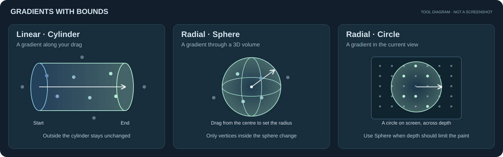
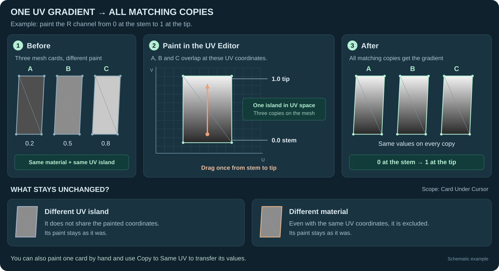
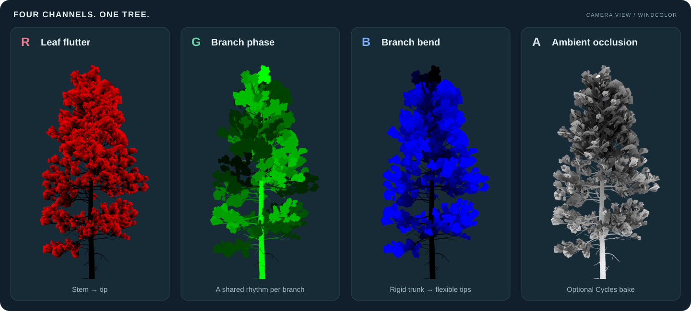

  

  A Blender add-on for painting wind vertex colours on trees. 
  Auto-paint your tree, draw gradients inside 3D bounds, or paint through shared UVs.

  <a href="https://github.com/zloy-pingvin/tree_wind_paint/releases"><strong>Download</strong></a>
  &nbsp; · &nbsp;
  <a href="#quick-start">Quick start</a>
  &nbsp; · &nbsp;
  <a href="#gradients-with-bounds">3D gradients</a>
  &nbsp; · &nbsp;
  <a href="#painting-through-uvs">UV painting</a>
  &nbsp; · &nbsp;
  <a href="#wind-preview">Wind preview</a>
  &nbsp; &middot; &nbsp;
  <a href="https://github.com/zloy-pingvin/tree_wind_paint/issues">Report a bug</a>

Blender 4.5+ · English & Russian UI

## What it does

Tree Wind Paint finds the trunk and branches, works out which branch each leaf belongs to, and paints the colours a wind shader needs. Twigs and leaves inherit their parent’s values at the joints, so the colours stay continuous where they meet.

**Paint within a volume:** draw a gradient along a branch and use its bounds to control exactly which vertices change. **Paint through UVs:** work on one leaf card in the UV Editor and update its copies together. You can also use Blender’s usual Vertex Paint brushes on each channel.

Preview the wind in Blender to see how the painted channels move the tree. The preview uses UNIGINE's wind formula; your engine's shader determines the final animation.

  
   
  <a href="https://youtu.be/d-5_-C4RA_E">▶ Quick overview</a>

## Installation

1. Download the extension ZIP from [Releases](https://github.com/zloy-pingvin/tree_wind_paint/releases).
2. In Blender, open **Edit → Preferences → Get Extensions**.
3. Open the dropdown menu and choose **Install from Disk…**, then select the ZIP.
4. In the 3D Viewport, press **N** and open **Tree Wind**.

You’ll also find a **Tree Wind** panel in the UV Editor sidebar. Cycles is needed only for the AO bake.

## Quick start

1. Select your tree mesh.
2. Check the material roles. Start with **Auto**, or set **Bark** and **Leaves** yourself.
3. Choose the **R G B A** channels to paint. Turn off **A** if you don’t need AO.
4. Press **Auto Paint**.
5. Open **Wind Preview** and press **Wind Preview** to check the tree in motion.

Use **Show Branches** to see how the tree was split into branches. If something looks wrong, check the material roles first. **Bare Branches** keeps dead or leafless wood rigid; **Skip** leaves faces unpainted. The **Tree Structure** settings let you adjust where the trunk splits into limbs.

Press **Show Wind Colors** to return to the painted result. In **Object Mode**, selecting one channel shows it in greyscale; turning on R, G and B shows the combined colours.

## Gradients with bounds

**Draw the gradient and choose the area it paints.** A linear gradient has a start, an end and a radius; a radial gradient can use a 3D sphere or a circle in the current view. This is useful when you want a smooth change along one branch or across a group of leaves.

Tool diagrams showing the painting bounds.

| Mode | What gets painted | How you control it |
| :--- | :--- | :--- |
| **Linear · Cylinder** | Vertices inside the cylinder between the two endpoints. Values change along its length; vertices outside its radius or past either end stay unchanged. | Drag from start to end. Turn the mouse wheel while dragging to change the radius. |
| **Radial · Sphere** | Vertices inside a sphere in 3D. Values change with distance from its centre. | Choose **Sphere**, then drag from the centre to set the radius. |
| **Radial · Circle** | Vertices inside the circle as seen from the current view, across depth. | Choose **Circle**, then drag out its radius on screen. |

To use them, choose **R**, **G**, **B** or **A** in **Manual Paint by Channel**, set the two brush values, and press **Linear** or **Radial**. Drag in the viewport. The guides show the bounds while you work.

Use **Replace**, **Add** or **Multiply** to mix the gradient with existing paint. Face and vertex selection masks narrow the affected area further; hidden elements are left alone. **X** swaps the values, **Ctrl + X** fills, and **Esc / right-click** cancels the gradient.

**Apply** writes the greyscale edits back into the original channel. **Cancel** discards them. You can use normal Vertex Paint brushes, **Levels** and **Randomize Parts** on the same channel too.

## Painting through UVs

**Paint one card and update its copies together.** When leaf cards share UV coordinates, a gradient drawn over their UV island can reach all the matching copies at once.

The same principle also lets you copy a hand-painted correction through shared UVs.

### Draw a UV gradient

1. Open **UV Editor → Sidebar → Tree Wind**.
2. Choose the channel, the two values and a **Linear** or **Radial** gradient.
3. Choose **Card Under Cursor** to work on the UV island where the drag starts and its overlapping copies, or **All Faces** to work across the faces shown by the tool.
4. Drag across the card. A linear gradient runs along the line; a radial gradient paints inside the circle you draw.

**Card Under Cursor** keeps the operation within the picked material. In Vertex Paint, selection masks also limit the result. **X** swaps the two values and **Ctrl + X** fills.

### Copy a painted leaf to its copies

Paint one leaf, then select its faces in **Edit Mode**, or in **Vertex Paint** with face selection masking on. Choose the RGB channels under **Paint by UV** and press **Copy to Same UV**.

Colours are copied to matching UV corners **within the same material**. While a channel is isolated, both UV tools edit that same greyscale copy, so **Apply** and **Cancel** still work on the whole edit.

## Wind preview

**See how your paint behaves while the tree moves.** Use the preview to check branch bending, leaf flutter and the joints between them before exporting.

1. Paint the tree, then open **Wind Preview** in the **Tree Wind** sidebar panel.
2. Press **Wind Preview**. A settings window opens and the timeline starts playing if it was stopped.
3. Adjust the wind and watch the result. If a joint pulls apart, check that the connected parts have matching colours there.
4. Press **Stop** or click outside the settings window to end the preview. Your settings are remembered on the object for next time.

| Settings | What they control |
| :--- | :--- |
| **Stem Offset, Radius, Speed, Noise** | Sway of the whole tree, based on height. |
| **Branch Offset, Speed** | Branch movement, weighted by **B**. |
| **Leaves Offset, Speed, Noise** | Leaf flutter, weighted by **R**. **G** offsets the animation phase between branches. |
| **Wind** | The wind vector. |

The preview follows UNIGINE's `mesh_base` formula with leaves set to *geometry vertex color based*. The parameter names and slider scaling follow that material, so you can enter its animation settings directly. Calculations use the mesh's local coordinates; object rotation and scale can make the result differ from the engine. Other wind shaders may interpret the colours differently.

The preview uses a temporary Geometry Nodes modifier and is suspended during AO baking. Stopping it removes the modifier. If it started timeline playback, it also stops playback and restores the starting frame; an already playing timeline keeps running.

## Wind channels

| Channel | Meaning | Values |
| :---: | :--- | :--- |
| **R** | Leaf flutter | 0 at the leaf’s stem, increasing towards its tip. Matching UV corners within the same material get matching values. |
| **G** | Phase / time offset | One value per branch, shared by its twigs and leaves. |
| **B** | Branch bend | 0 on the trunk, increasing towards the tips. Child branches continue from their parent’s value at the joint. |
| **A** | Ambient occlusion | Optional Cycles bake, with extra darkening near the ground controlled by **Ground Gradient**. |

The trunk stays at **B = 0** in this add-on because trunk sway is handled separately by the shader, usually by height. Engine conventions differ: the CRYENGINE and Lumberyard articles below describe an inverted blue bend channel. Check your shader’s expected values before exporting.

### How engines use vertex colours for wind

These guides explain the shader side of the workflow:

- [CRYENGINE 3 — Detail Bending](https://www.cryengine.com/docs/static/engines/cryengine-3/categories/1114113/pages/1310878)
- [UNIGINE — Vertex Color Vegetation](https://developer.unigine.com/en/docs/latest/videotutorials/how_to/how_to_rendering/vertex_color_vegetation)
- [SpeedTree Modeler — Lumberyard wind](https://docs.unity3d.com/speedtree-modeler/manual/wind-lumberyard.html)

The SpeedTree article covers its Lumberyard workflow; it does not describe every SpeedTree or Unity wind setup.

## Before exporting

1. Apply the channel edits you want to keep.
2. Stop **Wind Preview**. If **Remove Preview** is shown in the panel, press it; check that the `TWP_WindPreview` modifier is gone.
3. Switch to **Object Mode** and press **Show Wind Colors** to restore the wind colour display.
4. Remove any remaining `TWP_*` helper attributes and check that your exporter includes the wind colours.

## Questions or bugs?

[Open an issue](https://github.com/zloy-pingvin/tree_wind_paint/issues) with your Blender version and the steps that led to the problem. A small `.blend` file helps. Suggestions are welcome too.

Made by [zloy_pingvin](https://github.com/zloy-pingvin) · [Telegram](https://t.me/zloytux)

[GNU GPL v3 or later](LICENSE) · Copyright © 2026 zloy_pingvin
